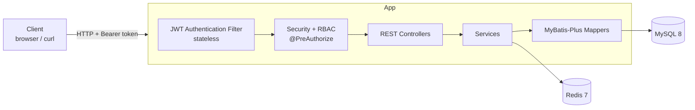
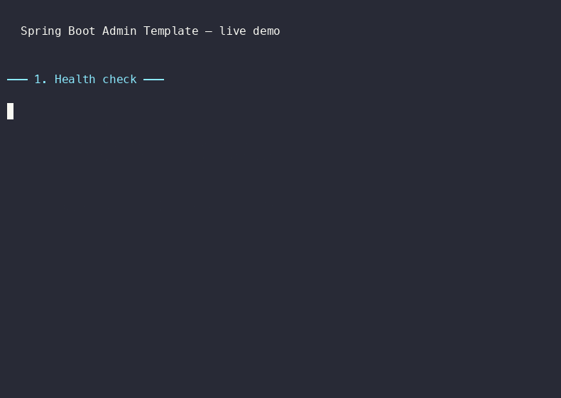

# Spring Boot Admin Template

A **production-ready Spring Boot admin backend template** — authentication, RBAC permissions, a generic CRUD example, Redis caching, and one-command Docker deployment. Clone it, extend it, and ship your own admin panel in minutes instead of weeks.

[](https://adoptium.net/)
[](https://spring.io/projects/spring-boot)
[](LICENSE)

## ✨ Features

- **Authentication** — register, login, JWT access + refresh tokens, logout, and stateless auth via a Spring Security filter.
- **RBAC permissions** — users, roles, and permissions with fine-grained `@PreAuthorize` method-level control (returns `403` on denial).
- **Generic CRUD example** — a complete article module you can copy to scaffold products, orders, or any other entity.
- **Redis caching** — a reusable `RedisService` wrapper plus login-state caching.
- **Docker one-command startup** — MySQL + Redis + app with health checks and seed data, all in one `docker compose up`.
- **Swagger / OpenAPI** — interactive API docs out of the box.
- **Tests** — unit tests (no database needed) and a full regression integration test suite.

## 🛠 Tech Stack

| Layer | Technology |
|---|---|
| Language | Java 17 |
| Framework | Spring Boot 3.3 |
| Security | Spring Security 6 + JWT (jjwt 0.12) |
| ORM | MyBatis-Plus 3.5 |
| Database | MySQL 8 |
| Cache | Redis 7 |
| API Docs | springdoc-openapi (Swagger UI) |
| Build | Maven |
| Deploy | Docker + docker-compose |

## 🏗 Architecture



```
src/main/java/com/dongh/admin/
├── AdminApplication.java      # entry point
├── common/                    # unified Result<T>, result codes, exceptions
├── config/                    # Security, MyBatis-Plus config
├── controller/                # auth / user / role / permission / article
├── dto/                       # request & response objects
├── entity/                    # JPA/MyBatis entities
├── mapper/                    # MyBatis-Plus mappers
├── security/                  # JWT util + authentication filter
└── service/                   # business logic (interfaces + impl)
```

## 🚀 Quick Start

The fastest way to get a running stack (MySQL + Redis + app) with seed data is Docker:

```bash
git clone git@github.com:dong1415889431/spring-boot-admin-template.git
cd spring-boot-admin-template
docker compose up -d --build
```

Once started, verify it's healthy:

```bash
curl http://localhost:8080/api/health
# {"status":"UP","app":"spring-boot-admin-template","time":"..."}
```

- **Swagger UI**: http://localhost:8080/swagger-ui.html
- **Default account**: `admin` / `admin123` (has all permissions)

> ⚠️ Before going to production, replace the JWT secret in `docker-compose.yml` (`JWT_SECRET`) and `application.yml` (`jwt.secret`) with a long random value (≥ 32 bytes).

## 💻 Local Development

Run MySQL and Redis first (either via Docker or your own installs):

```bash
docker compose up -d mysql redis
```

Then start the app:

```bash
mvn spring-boot:run
```

The default datasource connects to `localhost:3306/admin_template` (root / root123). Adjust `src/main/resources/application.yml` if your local setup differs.

## 🔐 Authentication Flow

1. `POST /api/auth/login` with `{ "username", "password" }` returns an `accessToken` and `refreshToken`.
2. Send the access token on every request: `Authorization: Bearer <accessToken>`.
3. When the access token expires, `POST /api/auth/refresh` with the refresh token to get a new pair.

The access token carries the user's permission codes, which Spring Security checks via `@PreAuthorize("hasAuthority('user:list')")`.

## 📚 API Overview

All endpoints return a unified `Result<T>` envelope: `{ "code": 0, "message": "success", "data": ... }` (`code = 0` means success).

### Auth — `/api/auth`

| Method | Path | Description | Auth |
|---|---|---|---|
| POST | `/register` | Register a new user | public |
| POST | `/login` | Login, returns tokens | public |
| POST | `/refresh` | Refresh tokens | public |
| GET | `/me` | Current user info | token |
| POST | `/logout` | Logout (clears cache) | token |

### Users — `/api/users`

| Method | Path | Permission |
|---|---|---|
| GET | `/` | `user:list` |
| PUT | `/{id}` | `user:update` |
| PUT | `/{id}/status` | `user:status` |
| DELETE | `/{id}` | `user:delete` |
| PUT | `/{id}/roles` | `user:assign-role` |
| GET | `/{id}/roles` | `user:list` |

### Roles — `/api/roles`

| Method | Path | Permission |
|---|---|---|
| GET | `/` | `role:list` |
| POST | `/` | `role:create` |
| PUT | `/{id}` | `role:update` |
| DELETE | `/{id}` | `role:delete` |
| PUT | `/{id}/permissions` | `role:assign-permission` |
| GET | `/{id}/permissions` | `role:list` |

### Permissions — `/api/permissions`

| Method | Path | Permission |
|---|---|---|
| GET | `/` | `permission:list` |

### Articles (generic CRUD example) — `/api/articles`

| Method | Path | Permission |
|---|---|---|
| GET | `/` | `article:list` |
| GET | `/{id}` | `article:list` |
| POST | `/` | `article:create` |
| PUT | `/{id}` | `article:update` |
| DELETE | `/{id}` | `article:delete` |

The article module is a template: copy `ArticleController`, `ArticleService(Impl)`, `ArticleMapper`, `Article` and `ArticleRequest`, rename and adjust the fields, and you have a new module wired into RBAC.

## 🧪 Running Tests

**Unit tests** (no database or Docker required):

```bash
mvn test
```

**Integration / regression tests** (require Docker — spins up MySQL + Redis via Testcontainers, exercises the full register → login → CRUD → permission flow):

```bash
mvn verify
```

**End-to-end smoke test** against a running instance:

```bash
docker compose up -d --build
bash scripts/smoke-test.sh
```

## 🎬 Demo



The `scripts/demo.sh` script walks through the whole flow (health → login → article CRUD → permission denial → logout) with readable output. Record it as a terminal screencast with [asciinema](https://asciinema.org/):

```bash
asciinema rec demo.cast -c "bash scripts/demo.sh"
```

Then embed the resulting `.cast` file in your docs, or convert it to a GIF with `agg` / `svg-term`.

## 💰 Free vs Paid Edition

This repository is the **free open-source edition** — auth, RBAC, generic CRUD, Redis, and Docker deployment: everything you need to run a production-ready admin backend.

The **paid edition** adds enterprise features on top:

| Feature | Free | Paid |
|---|---|---|
| Authentication + JWT | ✅ | ✅ |
| RBAC permissions | ✅ | ✅ |
| Generic CRUD example | ✅ | ✅ |
| Redis caching | ✅ | ✅ |
| Docker one-command deploy | ✅ | ✅ |
| Swagger / OpenAPI docs | ✅ | ✅ |
| Code generator | — | ✅ |
| Audit log | — | ✅ |
| File upload | — | ✅ |

### 🛒 Get the Full Version

The paid edition (code generator, audit log, file upload) will be available on Gumroad soon.

[Get it on Gumroad →](https://gumroad.com/l/spring-boot-admin-template)

## 🗺 Roadmap

- [x] Auth (register / login / JWT)
- [x] RBAC permissions
- [x] Generic CRUD example + Redis
- [x] Docker one-command deployment
- [x] English docs + regression tests
- [ ] Code generator, audit log, file upload (paid edition — coming soon)

## 📄 License

[MIT](LICENSE)
